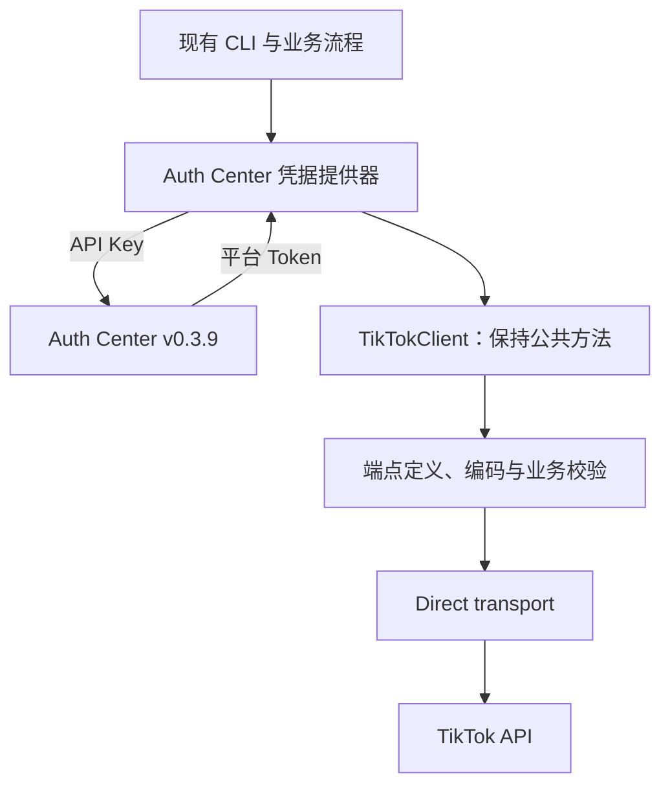

TikTok HTTP 客户端迁移实施方案

> 本文保留历史讨论。最新执行方案见仓库根目录 `plan.md`：固定 Auth Center v0.3.9 + API Key + Direct HTTP，取消本文的可选 Gateway 阶段；用量上报按 v0.3.9 的非幂等接口处理。冲突时以 `plan.md` 为准。

日期：2026-11-12（Asia/Shanghai）。状态：设计方案，尚未实施。基线：当前工作区，HEAD `1709e4b`；工作区已有未提交的网关与客户端改动，因此实施前需重新核对差异。本文不代表测试已通过、网关已全面开放或真实广告账户已验证。

认证决策更新：按用户指定的 Auth Center `v0.3.9` 对接，主路径采用 **API Key 获取平台 Token + Direct HTTP**，不新增 Gateway JWT 签发、验签、设备登录或续期体系。Gateway 作为可选扩展，若启用则实现显式的 API Key 身份校验；不能通过跳过现有 JWTVerifier 让请求匿名执行。Auth Center 自身控制台登录的 JWT 保持其原有职责。此处是方案调整，尚未修改任何认证代码。

已核对 [v0.3.9 发布说明](https://github.com/aspirincap/motata-auth-center/releases/tag/v0.3.9)、[OpenAPI 文档](https://github.com/aspirincap/motata-auth-center/blob/v0.3.9/OPENAPI.md) 和 [认证实现](https://github.com/aspirincap/motata-auth-center/blob/v0.3.9/backend/app/core/deps.py)：支持 `X-API-Key` 或 `Authorization: Bearer ak_...`；每个有效 Key 具有所属租户完整 OpenAPI 权限，旧 `scopes` 不再限制访问。Key 由服务端查找并校验，过期/失效 Key 被拒绝。不能从 Key 的字符串前缀推导可信身份。完整权限限于本租户的集成 API，不等于系统管理员权限。

**1. 交付目标与范围**

将 Motata 已有 TikTok 功能全部迁移到自维护 HTTP 客户端，最终删除 TikTok SDK 的运行时依赖。保留现有 CLI 命令、公共业务方法及成功响应约定，新增 Drama Series 工作流，并建立后续接口变更的维护入口。

将交付拆成三个可独立核验的结果：

| 结果 | 完成条件 |
|---|---|
| A：移除 SDK | 当前全部 TikTok 操作通过统一请求契约调用；运行、导入和打包均不再依赖 `business_api_client` |
| B：关键业务端到端可用 | 普通广告与 Smart+ 的查询、创建、更新、状态、素材、报表，以及 Drama Series 的指定流程，通过 CLI→Auth Center API Key 凭据获取→HTTP 客户端→模拟平台验证；真实账户验证另记证据 |
| C：变更维护机制 | 有来源可追溯的端点清单、schema 差异检测、兼容性测试与发布流程 |

BC、多账户、OAuth 账户发现等能力保持现有直连功能的兼容性；其网关开放需要匹配的授权模型，单独列出状态与后续任务。可选 Gateway 不作为主路径上线前置条件。A 完成不等于全部 CLI 的网关迁移完成。Meta 保留当前客户端；此次只复用已有基础设施，不同时重写 Meta 业务逻辑。

**2. 已核实的基线与必须处理的问题**

对当前 `TikTokClient` 做静态分析，共 74 个公共方法：42 个包含 SDK 路径，涉及 51 个不同 SDK 操作；27 个通过现有 raw HTTP 路径；1 个单独调用 `requests.get`；4 个为包装或生命周期方法。图片上传包含 SDK 与 HTTP 两种分支，归入 42 个含 SDK 路径的方法。这些数量是方法和操作数量，不是平台 API 的全量端点数。

| 已观察到的情况 | 方案中的处理 |
|---|---|
| SDK 自报 `1.2.1`，上游 revision 未核实；vendor 包含 348 个 Python 文件 | 迁移时保留旧实现作为离线请求对照来源，完成后从发布包删除 |
| 客户端构造时初始化 14 个 SDK API 对象 | 改为注入一个 transport，查询和创建都无需加载 SDK |
| `list_pages` 直接使用 `requests.get` | 纳入统一出口，防止遗漏网关路由 |
| `guard_command` 仍限制 handler，并阻止 `smart_plus=True` | 每个命令完成端到端测试后更新覆盖表；不能只修改服务端路径许可 |
| Gateway 对 TikTok 对象 ID 使用通用推导 | 对 Smart+ 的 `smart_plus_ad_id`、普通广告 ID、上传返回列表、异步任务分别定义结果提取规则 |
| SDK、raw HTTP、网关的错误行为不同 | 统一内部错误契约，保持用户可读信息与现有退出码兼容 |
| 报告层已有最多 3 次只读尝试 | 首版 transport 不再叠加自动重试，避免重试次数相乘 |
| npm 运行时健康检查仍 `import six` | 删除 SDK 时同步审计运行时检查、Python 依赖和发行包 |
| 既有网关状态文档与当前未提交实现不完全一致 | 重新生成命令/网络出口清单，以代码和测试证据更新状态 |

主要现有文件：[客户端](../motata_cli/tiktok/client.py)、[SDK 适配器](../motata_cli/transport/tiktok_sdk.py)、[网关入口限制](../motata_cli/transport/gateway.py)、[网关策略](../motata_gateway/policy.py)、[网关执行与结果解析](../motata_gateway/service.py)。

**3. 目标架构与技术选择**



API Key 仅发送到配置的 Auth Center，平台 Token 仅发送到对应平台。CLI 内部直接调用凭据提供器，不以 shell 命令打印 Token 再传回客户端。Direct 模式下平台 Token 会进入 CLI 进程内存，这是主路径的数据流。如果另行需要平台 Token 始终只留在服务端，则启用阶段 4 的 API Key Gateway 扩展。

直连继续使用 `requests.Session`，网关服务端继续使用已有的 `httpx.AsyncClient`。统一的是请求语义、端点定义和错误契约，无需强行把同步 CLI 与异步服务端改用同一 HTTP 库。

直连文件上传计划采用 `requests-toolbelt.MultipartEncoder`，新增依赖的准确版本在实现 PR 中核验并锁入发行依赖清单。其官方文档说明该编码器可以避免把整个文件读入内存。网关保留现有有界上传协议和异步 multipart 实现，双方用同一组字段与字节语义用例验证。[官方流式上传文档](https://toolbelt.readthedocs.io/en/latest/uploading-data.html)

| 拟新增模块（完整路径） | 职责 |
|---|---|
| `motata_cli/tiktok/endpoints.py` | 端点 ID、HTTP 方法、相对路径、读写分类、编码、API 版本、响应提取策略 |
| `motata_cli/tiktok/codec.py` | query、JSON、form、multipart 字段编码；无网络操作 |
| `motata_cli/tiktok/errors.py` | TikTok 业务码、HTTP 状态和写入结果的结构化错误 |
| `motata_cli/transport/tiktok_http.py` | Session、直连认证、超时、响应大小限制、上传与资源释放 |
| `motata_cli/auth_center/provider.py` | 复用既有 API Key 获取接口，处理账号/渠道选择、Token 有效期、错误和用量上报 |
| `motata_cli/tiktok/services/drama_series.py` | 剧集发现、两类推广模式校验、分步创建与恢复 |
| `docs/tiktok-endpoint-matrix.json` | 可审阅的迁移覆盖与文档来源清单；由脚本核验一致性 |
| `scripts/check_tiktok_http.py` | SDK 残留、未登记网络出口、端点覆盖和契约测试门禁 |

现有客户端作为兼容 facade，内部调用端点定义和 transport。端点清单描述能力，网关策略独立决定权限；下载的新清单不能自动扩大网关权限，也不能执行清单携带的代码。

最小请求契约包含 `endpoint_id`、`query`、`body`、`upload`、`operation_id`；transport 在本地受信任定义中解析路径与方法。响应在内部保留 HTTP 状态、平台原始 JSON、平台请求 ID 和网关写入结果，公共客户端继续返回既有字典结构。新增诊断元数据不直接混入旧命令的成功 JSON。

**4. 阶段 0：冻结基线与建立迁移清单（0.5–1 人日）**

1. 记录 HEAD、工作区改动文件与相关文件哈希，保存迁移前的脱敏请求样例及测试结果。保护现有工作区改动，按实际 diff 单独审阅迁移变更。
2. 生成操作级清单，记录：CLI 命令、客户端方法、旧 SDK 方法、路径、HTTP 方法、必填参数、编码、读写类别、分页方式、结果 ID、账号作用域、网关状态、测试和官方文档链接。
3. 对 51 个 SDK 操作读取实际生成代码；普通与 Smart+ 分支分别登记。对 27 个已有 HTTP 方法也登记，避免已有 HTTP 路径被当作无需验收。
4. 补齐 `list_pages`、OAuth/BC、多账户、异步任务和上传分支。为不属于平台鉴权请求的公共素材下载、URL 校验、网页解析单独标注，避免误纳入带 Token 的平台出口。
5. 用当前离线测试工具跑基线；已有失败先归因，记录通过、失败、未运行三种状态，不用修改断言来掩盖基线问题。

验收：74 个公共方法都有分类；51 个 SDK 操作都有迁移映射；每个网络入口都有用途和认证边界说明。

**5. 阶段 1：实现统一 HTTP 契约（2–3 人日）**

首先适配 v0.3.9 凭据契约：沿用既有 `X-API-Key` 支持；分清平台 OAuth scopes 与 Auth Center Key 的全租户权限，移除新设计中对 `token:read`/`token:deliver` 等旧 Key scopes 的依赖。处理 `401` 无效 Key、`402` 配额不足、`403` 租户访问失败、`404` 对象缺失以及限流/服务失败。

已知账号与 OAuth 身份绑定时优先使用精确身份 Token 交付接口。v0.3.9 的账号 Token 便利接口仍可能回退到同渠道 Token，适配不能把“返回一个 Token”当作目标账号权限证明；发送广告请求前核验目标账号的可访问性。遵守服务约定，在平台 Token 下游使用后上报 usage；上报失败不得重放广告操作，用同一事件 ID 进行可核查补报，其去重语义需在适配测试中确认。

编码规则：

| 场景 | 必须实现的行为 |
|---|---|
| GET | 参数放 query；dict/list 按端点规则 JSON 编码；不重复编码已有规范值；不发送 body |
| JSON POST | 保留嵌套对象、数组、数字和布尔类型，ID 按接口要求保持字符串 |
| form/multipart | 按端点定义编码对象和布尔值；文件与普通字段分开处理 |
| 缺省与清空 | 区分未提供、`null`、`[]`、`{}`、`false`、`0`、空字符串；禁止全局过滤空数组导致清空操作失效 |
| 扩展字段 | transport 不按旧 SDK 字段列表裁剪；业务验证层明确支持状态；网关独立执行字段与资源权限检查 |
| API 版本 | v1.3 集中配置并锁定，不跟随远程文档自动换版本；网关由服务端决定实际版本 |

传输行为：固定 TikTok HTTPS origin，禁止路径覆盖 host、携带凭据的重定向和隐式认证注入；禁止读取 `.netrc` 注入 Basic Auth。代理和 CA 配置明确化、纳入兼容测试，避免静默改变已有企业网络配置。可选网关模式通过 API Key 认证，并在服务端获取平台凭据；主路径使用 Auth Center 提供器取得的平台 Token。删掉 SDK 所需的伪 Access-Token，保留两类凭据明确的目的地址边界。

使用连接复用，支持 context manager/`close()`；由创建 Session 的对象负责关闭。普通请求初始沿用现有连接/读取超时，再为长报告和上传单独配置。流式读取响应并设上限；过大数据应明确失败或按分页策略缩小请求，不得被当作空列表。

统一错误携带 `http_status`、`platform_code`、`platform_request_id`、`category`、`retry_after`、`write_outcome`。HTTP 200 也必须校验 TikTok 业务码；缺失成功标记、非 JSON、畸形 JSON、空 body 分别处理。允许省略 `code` 的接口须有明确契约证据，不能全局默认为成功。

保留 `CliError` 兼容性。`common.output.error_kind` 优先读取新结构化分类，再回退到旧字符串逻辑，避免报告降级与限流判断失效。网关返回的已脱敏业务错误必须能保留必要分类信息。

重试规则：首版 direct transport 和 gateway upstream 均不自动重发；只读上层沿用当前最多 3 次总尝试，并测试上限。按操作语义标记只读与写入，POST 查询端点也必须显式分类。创建、更新、状态、上传和任务提交超时一律保留“结果未知”，不切换 SDK、直连或其他网关自动重发。

验收：编码、成功/失败解析、资源释放、认证隔离、只读重试上限与写入单次发送测试通过。

**6. 阶段 2：迁移查询、资产发现和报表（1.5–2 人日）**

| 批次 | 操作范围 | 重点校验 |
|---|---|---|
| R1 | Campaign/Ad group/Ad 查询、GMV Max 信息、`list_pages` | 过滤参数、fields、单项查询、完整保留未知响应字段 |
| R2 | 账户、Pixel、Offline event、App、优化事件、Identity、素材、Portfolio | 不同 collection key、字符串 ID、分页、空结果 |
| R3 | Integrated、GMV Max、Smart+ overview/breakdown | 维度与指标、日期、排序、分页、total、完整性标记 |
| R4 | 地域、定向、URL 校验、VBO、Catalog、Store、BC 与 OAuth 发现 | POST 查询语义；应用密钥与多账户上下文；网关可用性明确区分 |
| R5 | 已有 HTTP 的 AIGC、数字人、changelog 等状态/列表方法 | 任务 ID、轮询、code 检查、统一出口与超时 |

迁移前后用同一份输入构造离线请求，比较 method、path、query 和有效负载语义；允许的差异必须标注原因。对响应回放比较客户端输出、报告源文件及 `completeness`，不比较动态 trace ID 或耗时。

分页保持既有默认行为。自动分页必须检测重复页/游标、遵守调用方页数和行数上限，并明确标记截断；不能因为第二页失败而将第一页包装成完整成功。真实环境只读对照时考虑报告时区、归因窗口和数据延迟，不能要求不同时刻的消耗数完全一致。

验收：每个已迁移查询都有至少一个成功和一个关键失败契约用例；报告与资产发现端到端回放通过；不存在 `list_pages` 独立平台出口。

**7. 阶段 3：迁移写入、异步任务和媒体上传（3–4 人日）**

写入批次依次为：普通与 Smart+ Campaign → Ad group → Ad 的 create/update/status；账户与 Identity 更新/创建；创意 Portfolio、分享、删除和智能文案；已有 HTTP 的 AIGC/changelog 等任务提交；图片和视频上传。

每个写端点定义成功证据，覆盖 `campaign_id`、`adgroup_id`、普通广告返回 ID/列表、`smart_plus_ad_id`、素材返回列表和任务 ID。禁止所有创建接口共用 `data.ad_id` 或把 HTTP 200 当作已完成。任务提交成功和任务最终完成是两个状态，后者通过查询确认。

幂等分三层：本地业务 `operation_id`、网关 `idempotency_key`、TikTok 支持的请求字段。每个业务步骤生成并持久化稳定操作标识；只有官方明确支持的接口才发送平台幂等字段。相同操作重试复用相同键和 payload，不能在每次 CLI 重跑时悄悄生成新请求 ID。恢复状态只保存必要 IDs、摘要和进度，不保存 Token。

已有创建默认暂停/禁用行为保留。工作流失败时返回已创建对象与未完成步骤；不能从头重建全部对象，也不自动删除已有广告。更新的原值在计划阶段保存，确需撤销时使用明确的补偿步骤。

上传必须同时覆盖文件与 URL 模式：文件模式做大小、可读性、签名、MIME 和流式编码；URL 模式不要求本地文件存在。MD5 按端点要求计算，网关上传完整性使用现有 SHA-256，二者分别保留。网关接收字节，不接收用户机器上的文件路径。

响应超时、文件读取失败、客户端中断、网关中断、重复幂等键都需测试。对大文件分别测试内存峰值、临时磁盘占用和文件句柄释放。建议以 50 MiB 与 500 MiB 本地合成文件验证内存增量不随文件大小线性增长；前者与后者的增量差不超过预先声明的缓冲预算（初始目标 64 MiB）。合成测试不发往真实平台；平台大小上限由对应接口规则决定。

验收：全部写入方法不再调用 SDK；未知结果不重发；创建默认状态、更新清空语义、上传字节与文件释放通过验证。

**8. 阶段 4：可选 API Key 网关适配（独立估算，不阻塞 Direct 上线）**

v0.3.9 的现有 OpenAPI 没有独立 Key introspection 接口，也没有广告执行代理接口。若保留网关，有两种明确实现路线：在 Auth Center 服务内新增受 `get_api_key_context` 保护的广告执行路由，直接复用 Key 校验；或由独立网关调用新增的内部 Key 校验接口，获取经验证的 key ID、tenant ID 与有效状态。后者接口属于新增设计，不能当作 v0.3.9 现有能力使用。优先评估复用同服务认证，独立部署时再采用内部校验接口。

API Key 模式使用独立的调用者上下文，移除其对 JWT 的 sub/sid/jti/kid 等字段的依赖；不要伪造这些字段来绕过原有认证。按经过验证的 tenant/key ID 关联账号授权、审计和幂等记录。现有原始 Key 禁止进入平台请求、日志和操作回执。认证缓存如启用，需要明确有效期与撤销生效延迟。

1. 建立 CLI 命令→endpoint→scope→资源归属→响应解析→验收测试映射，以已验证能力逐项替换 `REVIEWED_HANDLERS` 的粗粒度限制。
2. 实际 CLI 入口测试普通和 Smart+ 分支，避免只测 `TikTokClient` 绕过入口拦截。业务方法只能选择显式配置的 direct 或 gateway，不得在网关拒绝后 fallback。
3. 网关为 `smart_plus_ad_id`/`smart_plus_ad_ids`、列表响应和新剧集/Identity 关系实现明确映射；查询建立的归属证据与写入校验使用同一标识体系。
4. 区分 advertiser、BC、应用级和多账户作用域；API Key 全租户 OpenAPI 权限不自动证明某平台资产归属。OAuth 发现所需 app secret 保留在既有直连管理用途，若未来通过网关实现则由服务端受信任配置提供，不能放宽普通平台请求的 secret 禁令。
5. 为报告、复制、bootstrap 和迁移工作流测试其全部依赖端点。允许入口前先执行能力预检，一次返回缺失能力，避免创建一半才发现下游网关不支持。
6. 修正网关错误分类与写入结果解析；成功回执可重放返回，unknown/pending 回执保持待核查。禁止为恢复任务重置 unknown 状态后直接重发。
7. 更新网络出口扫描：SDK 移除后删除硬编码的 vendor 出口，扫描 Session、transport、gateway 和辅助脚本，防止只统计 `requests.get` 漏掉新调用方式。

验收：选择实现此扩展后，承诺开放的命令均通过 CLI 子进程和模拟网关测试。无效/撤销 Key、跨租户、未授权账号、伪造对象 ID、未评审端点在平台调用前失败。未迁移网关能力继续显示 unavailable，不能把清单统一改成 complete。此扩展需要额外修改 Auth Center 或其内部校验接口，不计入无服务端改动的 Direct 核心交付。

**9. 阶段 5：Drama Series 首个新增能力案例（1.5–2.5 人日）**

官方参考：[创建指南](https://business-api.tiktok.com/portal/docs/create-an-upgraded-smart-mini-series-feed-campaign/v1.3)、[广告组创建](https://business-api.tiktok.com/portal/docs/create-an-upgraded-smart-ad-group/v1.3)、[广告组更新](https://business-api.tiktok.com/portal/docs/update-an-upgraded-smart-ad-group/v1.3)、[广告组查询](https://business-api.tiktok.com/portal/docs/get-upgraded-smart-ad-groups/v1.3)。实现时重新核对文档并记录来源快照；本文参数为当前已核实配置，不能替代账户资格验证。

| 步骤 | 实施内容 |
|---|---|
| 发现 | 通过 Identity 列表和 `/identity/native_series/get/` 发现广告账户可访问的身份与剧集，校验资产关系 |
| 计划 | Campaign 使用 `APP_PROMOTION` + `MINIS`；广告组使用 `NATIVE_SERIES` + `VALUE` + `AD_REVENUE_VALUE`；其余预算、排期、素材按文档和用户输入组成 |
| 自有剧集模式 | 使用可访问的 `native_series_id` 与匹配身份 |
| 分销模式 | 使用 `drama_selling_setting`；按指南不同时指定 `native_series_id`；检查分销能力及所需身份关系 |
| 校验 | 校验条件必填、身份一致性、CBO 共同配置、可更新/不可更新字段以及目标 ROAS 下同剧集同地区活动 Campaign 冲突 |
| 执行 | Campaign→Ad group→Ad，默认禁用，记录每步 ID、幂等键、请求摘要和结果 |
| 核验 | 查询新对象并比对关键配置和状态；响应有 ID 不代表已审核或可以开始投放 |
| 恢复 | 已确认成功的步骤复用；未知步骤先查询核实；输出部分成功和下一步，不从头重建 |

账户资格若无官方可查询信号，明确标记 `unknown`，根据 Ads Manager/已核实账号配置或受控操作结果确认，不能用“端点存在”推断白名单已开通。

建议新增命令（均为拟议名称，当前不可当作现有命令使用）：

```text
motata tiktok drama-series list
motata tiktok drama-series plan --payload-file ...
motata tiktok drama-series validate --plan-file ...
motata tiktok drama-series create --plan-file ...
```

plan 为本地构建；validate 允许读取账户/资产信息但不写平台；create 执行已校验计划。既有 `smartplus-*` 通用命令继续可用。新增 CLI 路由位于现有 registration，业务逻辑放入独立 service。

验收：两类模式都有有效/无效 payload 测试；流程中途失败和未知结果恢复测试通过；至少一个合资格测试账户完成禁用对象创建→查询→更新→查询。无账户资格时，只能记录离线和模拟验证完成，真实账户验收待完成。

**10. 阶段 6：删除 SDK、清理依赖并发布（1–2 人日）**

确认全部操作完成后删除 SDK 加载器、SDK 网关适配器和 vendor 目录；删除 `_invoke`、SDK 专用序列化与伪 Token。现有尚未启用的 Gateway JWT/login 代码不属于主路径依赖，其保留或删除单独审阅，不影响 Auth Center 控制台认证。通过历史基线保留迁移证据，无需在最终运行包继续携带旧 SDK。

依赖清理按实际 import 图执行：`six` 若只为 SDK 使用则移除；`urllib3`、`certifi` 仍可能由 Requests 间接依赖，不应宣称已从环境完全消失。同步处理项目直接依赖、发行锁定清单、package-data、第三方 notices、npm runtime 健康检查与安装测试。

重点现有文件：[项目依赖](../pyproject.toml)、[发行依赖](../requirements-release.txt)、[npm 运行时](../lib/runtime.js)、[打包检查](../scripts/check_release.py)、[网关清单脚本](../scripts/gateway_inventory.py)。

新增“干净安装无 SDK”验证：在无外部 `business_api_client`、无 `MOTATA_VENDOR_ROOT` 和无源码路径帮助的环境安装 wheel/npm 包，运行帮助、普通查询、Smart+ 请求构造、报告回放与上传模拟。源码树通过不等于发行包通过。

建议采用 `0.3.0rc1`→受控验证→`0.3.0` 的版本节奏，版本号需在实施时与当前发布状态协调。CLI、网关和能力清单分别记录兼容版本；客户端不得假定服务端同步升级。

回滚以部署到上一稳定包为主，开发期间可逐批回退代码。保留兼容的回执/恢复数据，迁移前备份并验证旧版本读取兼容性。应用回滚不会撤销平台已发生的创建或更新，unknown 写入也不能随版本回滚重新执行。

**11. 测试矩阵与发布门槛**

| 层级 | 必测内容 | 通过标准 |
|---|---|---|
| Auth Center v0.3.9 | 两种 Key header、租户隔离、失效/过期 Key、402、账号与 Token 关联、usage 上报 | 无额外 Gateway JWT 依赖；Key 与平台 Token 仅发送给各自服务；计费失败不重放广告 |
| 编码 | ID、Unicode、嵌套 JSON、bool、0、null、空数组、query 与 multipart | 与端点契约一致，新字段不被静默裁剪 |
| HTTP | 200 成功/业务失败、400/401/403/429/5xx、非 JSON、畸形/超大响应、超时、重定向 | 错误分类正确，凭据不进入日志或错误回显 |
| 写入 | 重复键、payload 变化、超时、缺少成功 ID、任务异步完成 | 不重复提交；冲突/未知状态明确 |
| 查询/报告 | 多页、重复页、空页、第二页失败、截断、指标不支持 | 完整性状态正确，既有报告输出兼容 |
| 上传 | file/URL、摘要、filename、字段类型、大文件、取消、并发 | 字节正确、资源释放、内存与临时文件受限 |
| 可选网关 | CLI guard、Key 认证、账号/对象关系、Token 隔离、结果提取 | 只有声明可用的路径端到端成功；失败无直连回退 |
| 业务流程 | 创建/更新/复制、素材发现、报表、Drama Series 恢复 | 无多余写入，部分成功可定位、可恢复 |
| 发行 | wheel、sdist 重建、npm 冷启动、SDK 不存在、Windows/Linux/macOS 冒烟 | 发布物与源码行为一致；覆盖的 OS 分别留证 |

离线测试以当前工具为基础，不访问真实账户：

```sh
python scripts/run_offline_tests.py
node --test tests/runtime.test.js tests/runtime-lock.test.js
python scripts/check_gateway.py
python scripts/check_release.py --pack-only
```

以上命令从 `仓库根目录` 执行。实现后补跑拟新增的 `scripts/check_tiktok_http.py`，以及现有 CI 中带离线 wheelhouse 的完整安装检查。现有 `check_gateway.py --release` 仍按全 CLI 网关覆盖判定，不能因为 TikTok SDK 移除而降低其标准；如有本期外网关缺口，应单独报告全局 gate 尚未通过。

本期硬门槛：51 个原 SDK 操作全部有契约映射和测试；所有已有 TikTok 平台网络请求纳入统一传输；SDK 运行/打包引用为零；API Key 凭据流程兼容 v0.3.9；写入未知结果不重发；真实平台验收状态单列。可选网关若宣布可用，必须另有入口到平台模拟的证据。

**12. 接口变更维护机制（独立后续 PR，2–3 人日）**

为端点记录 `api_version`、`schema_revision`、官方 URL、抓取时间、内容摘要、实现状态和验证证据。请求任务固定其使用的能力 revision，避免执行中发生规则变化。

在仓库 CI 中增加每日只读检查，优先官方 changelog/结构化定义，必要时解析官方文档。网页加载失败或出现登录页标记为“来源不可用”，不能误判为接口删除。比较路径、方法、字段类型、枚举、条件必填、不可修改项和下线日期。此处仅提出 CI 设计，未创建定时任务。

差异生成报告和候选补丁：文案变化只更新知识说明；参数变化补充 schema 与测试；新路径新增 adapter；破坏性变化保留旧 revision 并明确迁移策略。远程文档不是可执行代码或权限授权，候选变更通过测试和代码审阅后发布。若采用远程能力包，还需签名、兼容性检查、缓存和回滚。

建议新增查询入口（拟议名称）：`motata capabilities show tiktok`、`motata capabilities check`。展示“文档已发现／已实现／离线已验证／真实账户已验证／当前账户资格”，避免一个 SDK 版本号承担所有能力描述。

**13. PR 顺序、工期与实施检查表**

| PR | 内容 | 依赖 | 预计投入 |
|---|---|---|---|
| 1 | 基线、操作清单、迁移契约样例 | 无 | 0.5–1 人日 |
| 2 | endpoint/codec/HTTP/error 基础设施及 v0.3.9 API Key 凭据适配 | PR 1 | 2–3 人日 |
| 3 | 查询、发现、报表与已有 raw 路径 | PR 2 | 1.5–2 人日 |
| 4 | 创建/更新/状态/异步任务/上传 | PR 2，配合 PR 3 查询核验 | 3–4 人日 |
| 5（可选） | API Key 网关认证、CLI 与网关覆盖、归属和结果解析 | PR 3、4；需额外 Auth Center 服务端适配 | 单独估算 |
| 6 | Drama Series 业务流程 | PR 3、4；网关模式另依赖 PR 5 | 1.5–2.5 人日 |
| 7 | SDK 删除、依赖/发行包/文档、候选发布 | PR 3、4、6 | 1–2 人日 |
| 8 | 官方变更监测与能力查询入口 | PR 1、2 的清单与契约 | 2–3 人日 |

按 API Key + Direct 主路径，核心迁移与 Drama Series 初步约 10–15 人日，后续监测约 2–3 人日；可选 API Key 网关单独评估。这是基于已检查代码的工程估算，不是交付承诺；不包含平台白名单、测试账户权限、发布排期和 Auth Center 新服务端接口等待时间。进入阶段 0 后根据真实基线失败与接口清单修订估算。

- [ ] 记录当前工作区基线与已有改动。
- [ ] 生成方法、操作、CLI 和网关映射清单。
- [ ] 按 v0.3.9 接入 API Key 凭据提供器、账号核验和 usage 上报，主路径无 Gateway JWT 依赖。
- [ ] 统一编码、响应、错误与资源生命周期。
- [ ] 迁移查询/报告，并收拢 `list_pages` 等独立出口。
- [ ] 迁移全部写入与上传，验证稳定幂等及未知结果恢复。
- [ ] 若实现可选 Gateway，完成 API Key 校验及声明开放的 CLI→Gateway 路径测试。
- [ ] 补齐 Drama Series 两种推广模式与分步恢复。
- [ ] 移除 SDK 和无用直接依赖，验证干净发行包。
- [ ] 完成受控真实账户验收并记录未验证能力。
- [ ] 发布候选版本，验证回滚后再发布稳定版本。
- [ ] 单独接入官方接口变化监测。
